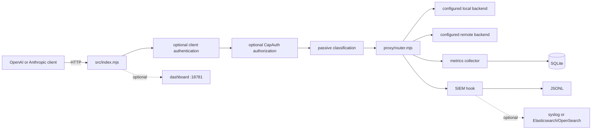

# SKGateway

SKGateway is a Node.js inference gateway that exposes OpenAI-compatible and Anthropic-compatible HTTP frontends and routes requests to configured model backends.

**Maturity-tier:** T0 - N/A (no key material; see [SOP.md](./SOP.md#9-maturity-tier--version-reference)).

**Version:** 0.1.0. **Runtime:** Node.js 20 or later. **License:** MIT.

> **Current-surface note:** This README describes behavior shipped in this repository. It does not claim that a particular deployment, provider credential, backend, or public route is active. Runtime availability depends on local configuration and backend health.

## What ships

The production entrypoint is [`src/index.mjs`](./src/index.mjs). The main request path buffers an incoming request, resolves routing context, and calls `routeAndSend()` in [`src/proxy/router.mjs`](./src/proxy/router.mjs).

| Surface | Shipped behavior | Evidence |
|---|---|---|
| Client protocols | OpenAI-style `/v1/chat/completions` and model listing, plus translation of Anthropic `/v1/messages` requests and responses | [`src/index.mjs`](./src/index.mjs), [`src/proxy/anthropic-frontend.mjs`](./src/proxy/anthropic-frontend.mjs), [`tests/anthropic-frontend.test.mjs`](./tests/anthropic-frontend.test.mjs), [`tests/stream-anthropic.test.mjs`](./tests/stream-anthropic.test.mjs) |
| Backend routing | Model and registry-role routing, priority ordering, backend health tracking, connection-pool admission, and bounded failover | [`src/proxy/router.mjs`](./src/proxy/router.mjs), [`tests/registry-failover.test.mjs`](./tests/registry-failover.test.mjs), [`tests/connection-pool-admission.test.mjs`](./tests/connection-pool-admission.test.mjs), [`tests/router-rate-limit-failover.test.mjs`](./tests/router-rate-limit-failover.test.mjs) |
| Model catalog | Static and discovered models are merged for `/v1/models`; lifecycle and configured availability can remove or flag entries | [`src/index.mjs`](./src/index.mjs), [`src/proxy/advertise.mjs`](./src/proxy/advertise.mjs), [`tests/advertise-lifecycle.test.mjs`](./tests/advertise-lifecycle.test.mjs), [`tests/discovery.test.mjs`](./tests/discovery.test.mjs) |
| Identity and authentication | Optional client and operator credential boundaries; agent identity can resolve from a CapAuth signature, a registered bearer, or `X-Agent-Id` | [`src/identity/client-auth.mjs`](./src/identity/client-auth.mjs), [`src/identity/capauth.mjs`](./src/identity/capauth.mjs), [`tests/client-auth-integration.test.mjs`](./tests/client-auth-integration.test.mjs), [`tests/capauth-identity.test.mjs`](./tests/capauth-identity.test.mjs) |
| Authorization | Optional delegation to a CapAuth policy decision point. Enforcement is disabled by default and fails closed when explicitly enabled | [`src/policy/authz_gate.mjs`](./src/policy/authz_gate.mjs), [`src/policy/authz_decide.mjs`](./src/policy/authz_decide.mjs), [`tests/authz-enforce-integration.test.mjs`](./tests/authz-enforce-integration.test.mjs) |
| Prompt classification | Passive intent, risk, jailbreak, and injection labels are emitted to SIEM when classification is enabled. These labels do not block or reroute requests | [`src/index.mjs`](./src/index.mjs), [`src/classifiers/engine.mjs`](./src/classifiers/engine.mjs), [`tests/classification-engine.test.mjs`](./tests/classification-engine.test.mjs) |
| Metrics | Optional SQLite request, token, cost, and latency recording, including per-backend/model P50, P95, and P99 estimates | [`src/metrics/collector.mjs`](./src/metrics/collector.mjs), [`tests/metrics-collector.test.mjs`](./tests/metrics-collector.test.mjs), [`tests/metrics-wiring-e2e.test.mjs`](./tests/metrics-wiring-e2e.test.mjs) |
| SIEM | The live entrypoint can append JSONL audit records and optionally forward events to syslog, Elasticsearch/OpenSearch, and the local SKCapstone file bus | [`src/index.mjs`](./src/index.mjs), [`src/siem/syslog.mjs`](./src/siem/syslog.mjs), [`src/siem/elasticsearch.mjs`](./src/siem/elasticsearch.mjs), [`src/integration.mjs`](./src/integration.mjs), [`tests/siem-live-hook.test.mjs`](./tests/siem-live-hook.test.mjs) |
| Dashboard | Optional HTTP and WebSocket server for stats, health, tokens, and costs | [`src/dashboard/server.mjs`](./src/dashboard/server.mjs), [`src/dashboard/static/index.html`](./src/dashboard/static/index.html), [`tests/startup-disablement.test.mjs`](./tests/startup-disablement.test.mjs) |
| Config reload | `SIGHUP` re-reads and validates YAML. A restart is still required for secrets and structural subsystem changes such as backend topology | [`src/config.mjs`](./src/config.mjs), [`src/index.mjs`](./src/index.mjs), [`config/skgateway.yaml.example`](./config/skgateway.yaml.example), [`docs/RUNBOOK.md`](./docs/RUNBOOK.md) |

### Important scope boundaries

The repository also contains implemented modules that are **not invoked by the production `src/index.mjs` request path**:

- The alternate embeddable proxy core in [`src/proxy/core.mjs`](./src/proxy/core.mjs) performs tool reduction, history trimming, response sanitization, and its own retry sequence. Its behavior is covered by [`tests/sanitizer.test.mjs`](./tests/sanitizer.test.mjs) and [`tests/retry.test.mjs`](./tests/retry.test.mjs).
- The YAML policy engine and rate limiter in [`src/policy/engine.mjs`](./src/policy/engine.mjs) and [`src/policy/ratelimit.mjs`](./src/policy/ratelimit.mjs) are library modules. They are not the optional CapAuth authorization gate described above.
- DLP/PII scanning helpers in [`src/proxy/sanitizer.mjs`](./src/proxy/sanitizer.mjs) are not a blocking DLP boundary on the production route.
- The reusable rotating file adapter and generic event bus in [`src/siem/file.mjs`](./src/siem/file.mjs) and [`src/siem/events.mjs`](./src/siem/events.mjs) are not used for the live JSONL append in `src/index.mjs`. The live append therefore must not be described as rotated merely because `rotate_mb` appears in YAML.
- The dashboard's server-side event and activity rings are not fed by the live gateway SIEM hook. When no activity is available, the current browser UI inserts demo activity and security events and starts with sample classification values. Treat those panels as demonstration UI, not an operational audit source. See [`src/dashboard/server.mjs`](./src/dashboard/server.mjs) and [`src/dashboard/static/index.html`](./src/dashboard/static/index.html).

## Architecture



The gateway does not make a backend sovereign by itself. Prompts leave the host whenever routing selects a remote provider. A local-only inference path requires local backend URLs, suitable trust-zone policy, and network controls configured by the operator. Routing and sensitivity behavior is implemented in [`src/proxy/router.mjs`](./src/proxy/router.mjs) and [`src/policy/sensitivity.mjs`](./src/policy/sensitivity.mjs), with coverage in [`tests/sensitivity-trust-zone.test.mjs`](./tests/sensitivity-trust-zone.test.mjs) and [`tests/trust-zone-provider-wiring.test.mjs`](./tests/trust-zone-provider-wiring.test.mjs).

## Quick start

### Prerequisites

- Node.js 20 or later, as declared in [`package.json`](./package.json).
- npm.
- At least one reachable backend configured for the model you request.
- Any provider credential required by that backend, supplied outside the repository.

### Install and validate

```bash
git clone https://github.com/smilinTux/skgateway.git
cd skgateway
npm ci
node --check src/index.mjs
npm test
```

`npm test` runs all `tests/*.test.mjs` through Node's built-in test runner, as defined in [`package.json`](./package.json). CI runs the locked install and test suite on Node 20 and 22; see [`.github/workflows/ci.yml`](./.github/workflows/ci.yml).

### Configure

Start from the public template and replace placeholder backend addresses with endpoints reachable from your host:

```bash
cp config/skgateway.yaml.example config/skgateway.local.yaml
${EDITOR:-vi} config/skgateway.local.yaml
```

Do not put credential values in YAML. Backend entries name an environment variable or a credential-file path. The secret-handling contract is documented in [`SECURITY.md`](./SECURITY.md) and [`docs/COLD-BOOTSTRAP.md`](./docs/COLD-BOOTSTRAP.md).

Config path precedence is:

1. `--config PATH`
2. `SKGATEWAY_CONFIG`
3. `~/.skcapstone/gateway/skgateway.yaml`
4. `config/skgateway.yaml` in the checkout

Evidence: [`src/config.mjs`](./src/config.mjs) and [`tests/config-path-resolution.test.mjs`](./tests/config-path-resolution.test.mjs).

### Start

```bash
node src/index.mjs --config ./config/skgateway.local.yaml
```

The only entrypoint flags are `--config` and `--port`. Development watch mode is `npm run dev -- --config ./config/skgateway.local.yaml`.

Default ports are:

| Listener | Default | Evidence |
|---|---:|---|
| Gateway | `18780` | [`src/config.mjs`](./src/config.mjs) |
| Dashboard, when enabled | `18781` | [`src/config.mjs`](./src/config.mjs), [`src/dashboard/server.mjs`](./src/dashboard/server.mjs) |

The shipped default bind is `0.0.0.0`, not loopback. Review the exposure analysis in [`SOP.md`](./SOP.md#2-front-end--exposure) before starting the service, and set `server.bind: 127.0.0.1` when LAN access is not required.

### Verify

```bash
curl -fsS http://127.0.0.1:18780/health
curl -fsS http://127.0.0.1:18780/v1/models
```

A completion request uses the normal OpenAI chat shape:

```bash
curl -sS http://127.0.0.1:18780/v1/chat/completions \
  -H 'Content-Type: application/json' \
  -H 'X-Agent-Id: readme-check' \
  -d '{
    "model": "MODEL_CONFIGURED_ON_THIS_HOST",
    "messages": [{"role": "user", "content": "Reply with hello."}],
    "max_tokens": 20
  }'
```

This call can contact the selected backend and can incur provider cost. Replace the model deliberately. Do not use a production credential as a documentation check.

## Security and policy defaults

The following defaults matter because implemented code is not the same as enforced policy:

| Control | Default | Effect | Evidence |
|---|---|---|---|
| `client_auth.enabled` | `false` | The dedicated client credential boundary is off unless explicitly configured | [`src/config.mjs`](./src/config.mjs), [`tests/client-auth.test.mjs`](./tests/client-auth.test.mjs) |
| `operator_auth.enabled` | `false` | The dedicated operator credential boundary is off unless explicitly configured | [`src/config.mjs`](./src/config.mjs), [`tests/client-auth.test.mjs`](./tests/client-auth.test.mjs) |
| `identity.enabled` | `true` | Identity resolution runs, but anonymous callers are allowed by default | [`src/config.mjs`](./src/config.mjs), [`tests/capauth-identity.test.mjs`](./tests/capauth-identity.test.mjs) |
| `identity.require_agent_id` | `false` | Anonymous requests are not rejected by the identity gate | [`src/config.mjs`](./src/config.mjs), [`tests/capauth-identity.test.mjs`](./tests/capauth-identity.test.mjs) |
| `authz.enforce` | `false` | No policy-decision call or authorization denial occurs until enforcement is enabled | [`src/config.mjs`](./src/config.mjs), [`tests/authz-enforce-integration.test.mjs`](./tests/authz-enforce-integration.test.mjs) |
| `classification.enabled` | `true` | Prompt labels are observed and logged; `classification.gate` is reserved and defaults off | [`src/config.mjs`](./src/config.mjs), [`tests/classification-engine.test.mjs`](./tests/classification-engine.test.mjs) |
| `routing.match_enabled` | `false` | Capability-aware `@match` routing and `x-sk-require` routing are dark by default | [`src/config.mjs`](./src/config.mjs), [`tests/router-match.test.mjs`](./tests/router-match.test.mjs) |

Enabling an authentication or authorization flag is an operator decision, not a claim that the control is active on every installation. See [`SECURITY.md`](./SECURITY.md), [`docs/CONFIGURATION.md`](./docs/CONFIGURATION.md), and [`docs/RUNBOOK.md`](./docs/RUNBOOK.md).

## Routing and failover

For a concrete model, the router selects eligible configured backends by model match and priority. It tracks observed outcomes, can quarantine repeatedly failing aliases, and can advance to another candidate on server failures and configured throttle conditions. A never-observed backend reports health as `unknown` while remaining selectable. Evidence: [`src/proxy/router.mjs`](./src/proxy/router.mjs), [`tests/health-never-probed.test.mjs`](./tests/health-never-probed.test.mjs), [`tests/quarantine.test.mjs`](./tests/quarantine.test.mjs), and [`tests/router-rate-limit-failover.test.mjs`](./tests/router-rate-limit-failover.test.mjs).

Dynamic discovery is configuration-dependent. NVIDIA and OpenRouter discovery default on in code; newer providers such as OpenCode, Anthropic wrapper discovery, Codex, and Z.ai are opt-in. Discovery failures use cached or static information where available and do not prove a provider is healthy. Evidence: [`src/index.mjs`](./src/index.mjs), [`src/discovery.mjs`](./src/discovery.mjs), and provider tests under [`tests/providers-*.test.mjs`](./tests/).

Local-backend health failover is controlled by these environment variables:

| Variable | Default | Meaning |
|---|---|---|
| `SKGATEWAY_LOCAL_FAILOVER` | `1` | Enable the local/private backend failover branch |
| `SKGATEWAY_LOCAL_FALLBACK_MODEL` | `deepseek-ai/deepseek-v4-flash` | Fallback model |
| `SKGATEWAY_LOCAL_FALLBACK_BACKEND` | `nvidia` | Configured backend expected to serve the fallback |
| `SKGATEWAY_LOCAL_HEALTH_TIMEOUT_MS` | `3000` | Liveness-probe timeout |
| `SKGATEWAY_LOCAL_COMPLETION_TIMEOUT_MS` | `10000` | Local completion timeout |
| `SKGATEWAY_LOCAL_HEALTH_TTL_MS` | `20000` | Cached health-verdict lifetime |

These defaults are defined and tested in [`src/proxy/local-failover.mjs`](./src/proxy/local-failover.mjs) and [`tests/local-failover.test.mjs`](./tests/local-failover.test.mjs). A fallback backend still needs valid configuration and, when applicable, credentials.

## API summary

### Gateway listener

| Method | Path | Current behavior | Evidence |
|---|---|---|---|
| `GET` | `/health`, `/healthz` | Process uptime and observed backend health | [`src/index.mjs`](./src/index.mjs) |
| `GET` | `/status` | Version, uptime, backend health, pool state, and metrics snapshot | [`src/index.mjs`](./src/index.mjs) |
| `GET` | `/queue` | Connection-pool utilization and backend queue state | [`src/index.mjs`](./src/index.mjs), [`tests/connection-pool-admission.test.mjs`](./tests/connection-pool-admission.test.mjs) |
| `GET` | `/v1/models` | Reconciled and allowlisted model catalog | [`src/index.mjs`](./src/index.mjs), [`tests/advertise-lifecycle.test.mjs`](./tests/advertise-lifecycle.test.mjs) |
| `GET` | `/v1/models/:id` | Retrieve a catalog model or synthesized `sk-*` registry role | [`src/index.mjs`](./src/index.mjs), [`tests/anthropic-frontend.test.mjs`](./tests/anthropic-frontend.test.mjs) |
| `POST` | `/v1/chat/completions` | Routed OpenAI-style chat completion | [`src/index.mjs`](./src/index.mjs), [`tests/siem-live-hook.test.mjs`](./tests/siem-live-hook.test.mjs) |
| `POST` | `/v1/messages` | Anthropic request translation through the same routing path | [`src/index.mjs`](./src/index.mjs), [`tests/anthropic-frontend.test.mjs`](./tests/anthropic-frontend.test.mjs) |

Loopback admin and operator-facet routes also ship. Their exact contracts are documented in [`docs/API.md`](./docs/API.md), [`src/index.mjs`](./src/index.mjs), and [`src/operator/http.mjs`](./src/operator/http.mjs). Do not infer that a loopback-only route is safe after placing an unauthenticated forwarding proxy in front of it.

### Dashboard listener

| Method | Path | Current behavior |
|---|---|---|
| `GET` | `/` | Static dashboard application |
| `GET` | `/api/stats` | In-memory metrics snapshot |
| `GET` | `/api/health` | Router health snapshot |
| `GET` | `/api/agents` | Active sessions grouped by agent |
| `GET` | `/api/tokens` | SQLite token rows when metrics are enabled |
| `GET` | `/api/costs` | SQLite cost rows when metrics are enabled |
| `GET` | `/api/events` | Dashboard server's in-memory event ring |
| `GET` | `/api/activity` | Dashboard server's in-memory activity ring |
| WebSocket | `/ws` | Periodic stats and health frames, plus events directly pushed into the dashboard server |

Evidence for this table is [`src/dashboard/server.mjs`](./src/dashboard/server.mjs). The event/activity and demo-data limitation is stated under [Important scope boundaries](#important-scope-boundaries).

## Observability

The live router emits correlated auth, request, failover, error, and response events through the SIEM callback. Response events include status, latency, and best-effort token usage when the response exposes usage. Evidence: [`src/proxy/router.mjs`](./src/proxy/router.mjs) and [`tests/siem-live-hook.test.mjs`](./tests/siem-live-hook.test.mjs).

With metrics enabled, the collector records request/response pairs in SQLite, computes configured-model costs, and retains latency estimators in memory. Unknown pricing is represented as unpriced rather than inventing a cost. Evidence: [`src/metrics/collector.mjs`](./src/metrics/collector.mjs) and [`tests/metrics-collector.test.mjs`](./tests/metrics-collector.test.mjs).

For sink configuration and operational limitations, see [`docs/SIEM.md`](./docs/SIEM.md) and [`docs/DASHBOARD.md`](./docs/DASHBOARD.md).

## SKCapstone integration

Integration is file-based and optional. When `~/.skcapstone/` is present and standalone mode is not forced, the adapter can:

- forward warning-or-higher SIEM events to `~/.skcapstone/pubsub/topics/skgateway.<level>/`; and
- register gateway health metadata at `~/.skcapstone/registry/skgateway.json`.

When `SK_STANDALONE=1` is set, these operations are no-ops. Evidence: [`src/integration.mjs`](./src/integration.mjs) and [`tests/integration.test.mjs`](./tests/integration.test.mjs).

This repository does not evidence claims that every SKCapstone, SKVoice, SKMemory, OpenClaw, or other ecosystem request currently traverses SKGateway. Each consumer must be configured and qualified separately.

## Development

```bash
npm ci
npm test
```

Useful targeted checks include:

```bash
node --test --import ./tests/_setup.mjs tests/router-rate-limit-failover.test.mjs
node --test --import ./tests/_setup.mjs tests/client-auth-integration.test.mjs
node --test --import ./tests/_setup.mjs tests/metrics-collector.test.mjs
node --test --import ./tests/_setup.mjs tests/siem-live-hook.test.mjs
```

Contribution rules, including the branch model, test gate, writing style, and review path, are in [`CONTRIBUTING.md`](./CONTRIBUTING.md).

## Documentation index

- [Installation](./docs/INSTALL.md)
- [Configuration](./docs/CONFIGURATION.md)
- [API](./docs/API.md)
- [Architecture](./docs/ARCHITECTURE.md)
- [Policies](./docs/POLICIES.md)
- [SIEM](./docs/SIEM.md)
- [Dashboard](./docs/DASHBOARD.md)
- [Operations runbook](./docs/RUNBOOK.md)
- [Security](./SECURITY.md)
- [Standard operating procedures](./SOP.md)
- [Changelog](./CHANGELOG.md)

## License

MIT. See [`LICENSE`](./LICENSE).

## Related projects / See also

- **Depends on:** [capauth](https://github.com/smilinTux/capauth) for optional policy-decision delegation and CapAuth identity formats.
- **Used by:** [skcapstone](https://github.com/smilinTux/skcapstone) can consume the optional file-based service registration and warning event bridge.
- **Sibling:** [skops](https://github.com/smilinTux/skops) provides related operational and ITIL surfaces.
- **Standards:** [sk-standards](https://github.com/smilinTux/sk-standards) defines the repository documentation, ingress, authorization, and observability standards referenced by this project.
